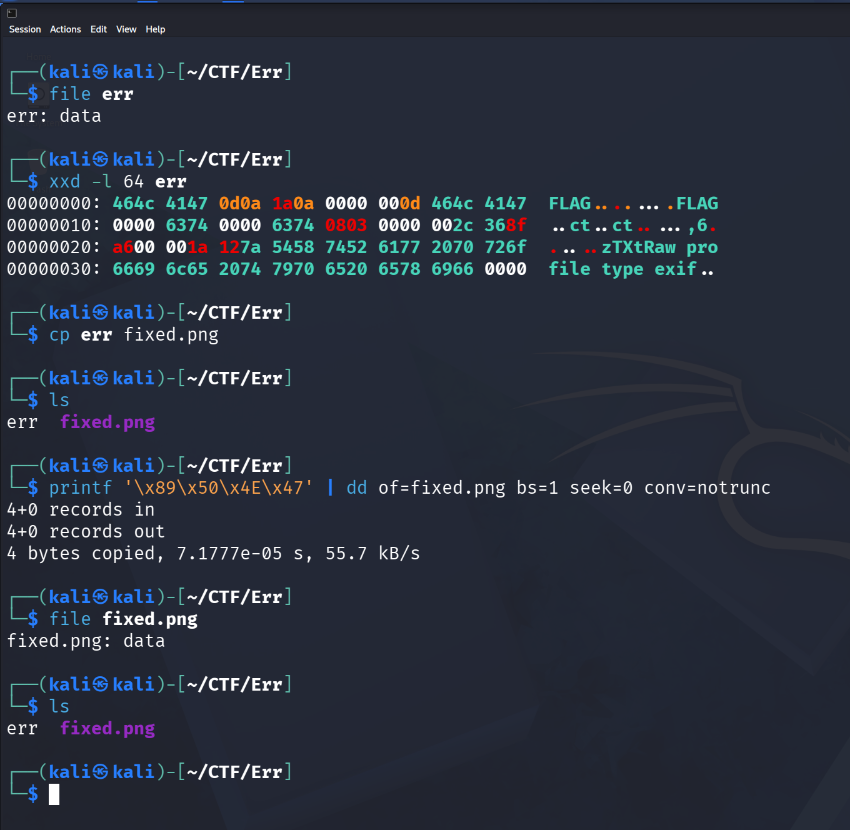
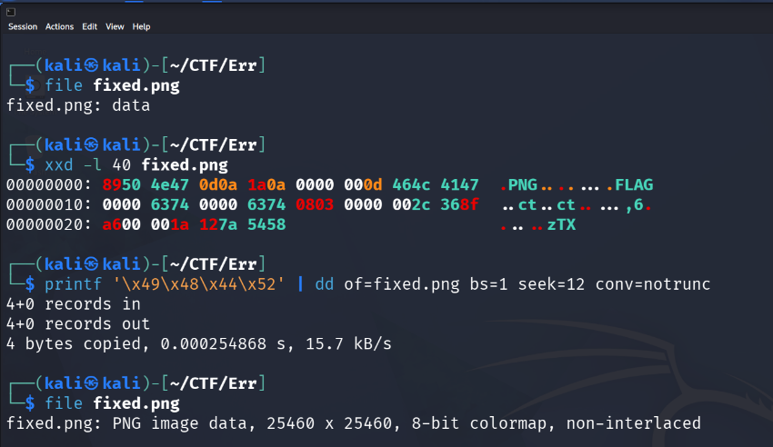
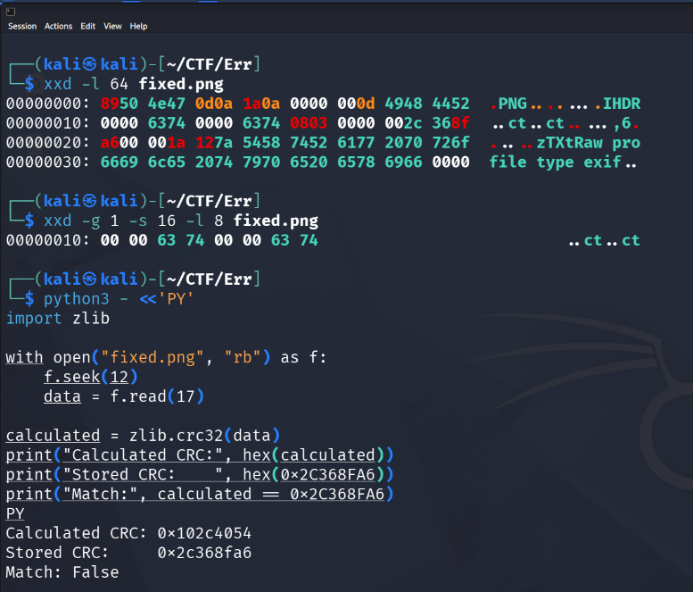
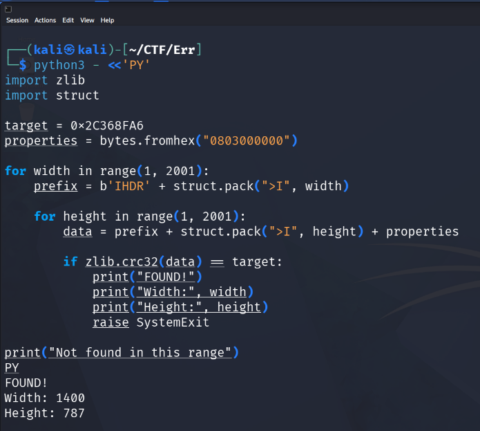
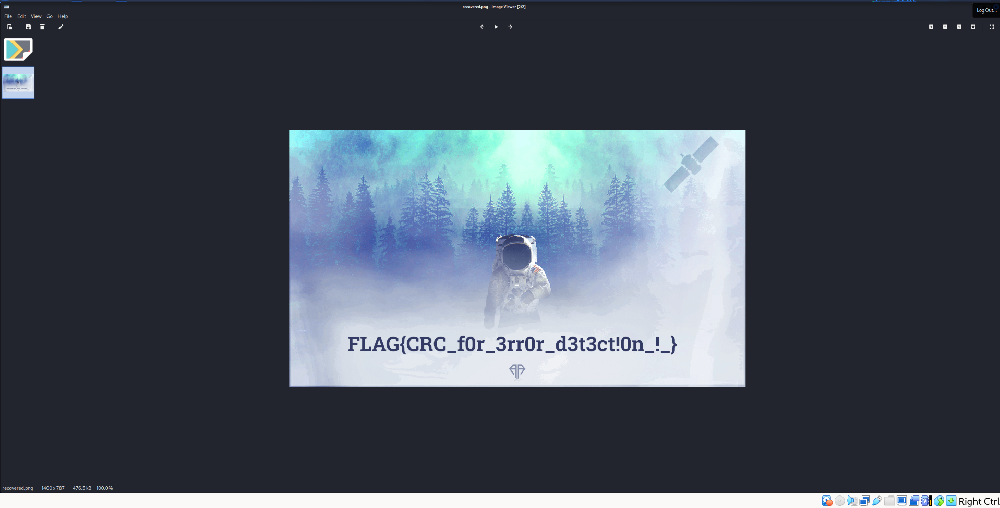

# CyberTalents — Err (Digital Forensics)

**Challenge :** [Err](https://cybertalents.com/challenges/forensics/err)  
**Catégorie :** Digital Forensics  
**Méthode :** inspection hexadécimale, réparation PNG et récupération des dimensions par CRC32.

> ⚠️ Spoilers : cette page décrit toute la solution, y compris le flag.

## 1. Identifier le fichier

Le fichier téléchargé se nomme `err`. La première vérification ne reconnaît pas son format :

```bash
file err
# err: data
```

La commande `file` essaie d'identifier le format en examinant notamment les octets caractéristiques en début de fichier. Nous inspectons ces octets avec :

```bash
xxd -l 64 err
```

Le fichier commence par `46 4C 41 47 0D 0A 1A 0A`. Les quatre premiers octets sont les caractères ASCII `FLAG`. Les quatre suivants correspondent à la fin de la signature PNG `89 50 4E 47 0D 0A 1A 0A`. L'hypothèse est donc un **en-tête PNG modifié**.



## 2. Réparer la signature PNG

Nous gardons le fichier original intact et travaillons sur une copie :

```bash
cp err fixed.png
printf '\x89\x50\x4E\x47' | dd of=fixed.png bs=1 seek=0 conv=notrunc
file fixed.png
```

`printf` produit les octets attendus. `dd` les écrit à partir de l'offset `0` (`seek=0`) sans tronquer le reste du fichier (`conv=notrunc`). Le fichier reste pourtant identifié comme `data` : il existe au moins une autre anomalie.

## 3. Restaurer le chunk IHDR

La structure du début d'un PNG est :

| Offset (décimal) | Taille | Élément |
|---|---:|---|
| 0–7 | 8 octets | Signature PNG |
| 8–11 | 4 octets | Longueur du premier chunk |
| 12–15 | 4 octets | Type du chunk : `IHDR` |
| 16–19 | 4 octets | Largeur |
| 20–23 | 4 octets | Hauteur |
| 24–28 | 5 octets | Propriétés de l'image |
| 29–32 | 4 octets | CRC32 du chunk IHDR |

La longueur observée `00 00 00 0D` représente **13 octets**. Juste après, le nom du chunk est `FLAG` au lieu de `IHDR`. Nous remplaçons donc les quatre octets situés à l'offset `12` :

```bash
printf '\x49\x48\x44\x52' | dd of=fixed.png bs=1 seek=12 conv=notrunc
file fixed.png
# fixed.png: PNG image data, 25460 x 25460, 8-bit colormap, non-interlaced
```

Le format est reconnu, mais les dimensions **25460 × 25460** sont suspectes.



## 4. Comprendre le problème des dimensions

```bash
xxd -l 64 fixed.png
```

Les dimensions sont stockées en **big-endian** dans les octets `16–23` :

```text
Width  : 00 00 63 74  = 25460
Height : 00 00 63 74  = 25460
```

`63 74` correspond aussi au texte `ct` en ASCII. Pour vérifier l'intégrité du chunk, nous comparons son **CRC32 stocké** au **CRC32 recalculé**. Le CRC couvre le type `IHDR` (4 octets) et ses données (13 octets), soit 17 octets à partir de l'offset 12.

```python
import zlib

with open('fixed.png', 'rb') as f:
    f.seek(12)
    data = f.read(17)

calculated = zlib.crc32(data)
stored = 0x2C368FA6
print(hex(calculated))  # 0x102c4054
print(hex(stored))      # 0x2c368fa6
print(calculated == stored)  # False
```

Le décalage des CRC confirme une incohérence entre le contenu actuel du chunk et la valeur enregistrée. Nous allons tester l'hypothèse de dimensions remplacées.



## 5. Retrouver les dimensions avec CRC32

Le script teste des largeurs et hauteurs entre 1 et 2000, en gardant inchangées les autres propriétés du chunk :

```python
import zlib
import struct

target = 0x2C368FA6
properties = bytes.fromhex('0803000000')

for width in range(1, 2001):
    prefix = b'IHDR' + struct.pack('>I', width)
    for height in range(1, 2001):
        data = prefix + struct.pack('>I', height) + properties
        if zlib.crc32(data) == target:
            print(f'FOUND: {width} x {height}')
            raise SystemExit
print('No match in range')
```

Résultat :

```text
FOUND: 1400 x 787
```

`struct.pack('>I', value)` encode chaque dimension sur quatre octets big-endian, comme l'exige PNG. Le CRC correspondant aux dimensions **1400 × 787** est identique au CRC enregistré. C'est un candidat solide, même si un CRC ne constitue pas une preuve cryptographique d'unicité.



## 6. Réparer et ouvrir l'image

Nous appliquons ces dimensions sur une nouvelle copie :

```bash
cp fixed.png recovered.png
printf '\x00\x00\x05\x78\x00\x00\x03\x13' | \
  dd of=recovered.png bs=1 seek=16 conv=notrunc
file recovered.png
xdg-open recovered.png
```

`00 00 05 78` encode la largeur **1400** et `00 00 03 13` encode la hauteur **787**. Le fichier devient lisible, et l'image restaurée affiche le flag.



## Flag

```text
FLAG{CRC_f0r_3rr0r_d3t3ct!0n_!_}
```

## Conclusion

Ce challenge montre qu'une image qui semble illisible peut être récupérée en étudiant sa structure binaire. Les principales étapes ont été : identifier une signature altérée, réparer le chunk `IHDR`, utiliser le CRC32 pour tester des dimensions possibles et ouvrir enfin l'image restaurée.

**Version PDF :** [Err-Writeup.pdf](Err-Writeup.pdf)  
