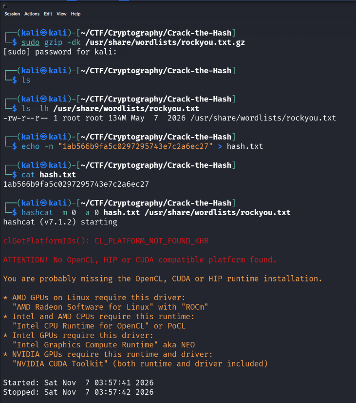
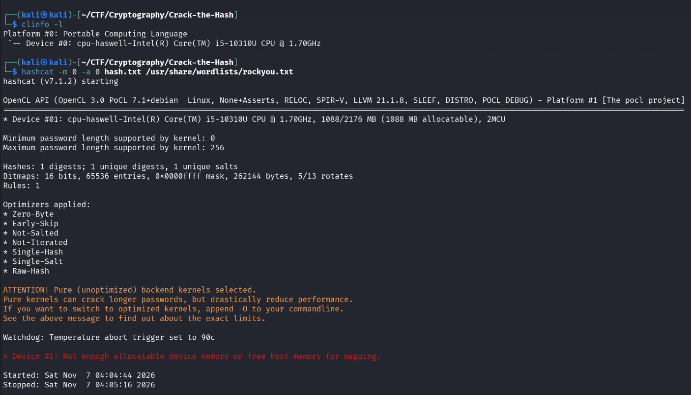
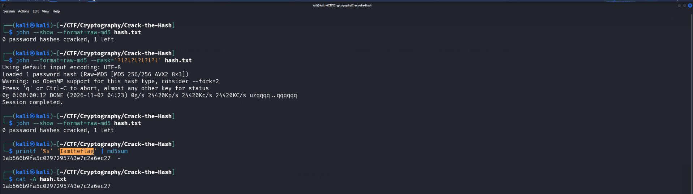
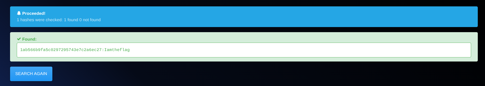

# Crack the Hash — CyberTalents

   

> **Challenge:** [Crack the Hash — CyberTalents](https://cybertalents.com/challenges/cryptography/crack-the-hash)  
> **Environment:** Kali Linux  
> **Tools:** `hashcat`, `john`, `md5sum`, CrackStation, Hashes.com

## 1. Objective

The challenge provides a leaked password hash and asks us to recover the CEO's original password.

```text
1ab566b9fa5c0297295743e7c2a6ec27
```

The goal is to identify the likely hash algorithm, attempt suitable recovery techniques, and **verify** the recovered candidate before submitting it.

## 2. Hash identification

The string contains **32 hexadecimal characters** (`0–9`, `a–f`), corresponding to 128 bits when decoded as hex. This is consistent with a standard **MD5** digest, although length alone cannot uniquely identify the algorithm.

```bash
printf '%s' '1ab566b9fa5c0297295743e7c2a6ec27' | wc -c
# 32
```

MD5 is a one-way hash function, **not encryption**. Password recovery here means finding a candidate whose MD5 digest matches the target; it does not mean decrypting MD5.

## 3. Local cracking attempts

### 3.1 Prepare the hash and wordlist

```bash
printf '%s\n' '1ab566b9fa5c0297295743e7c2a6ec27' > hash.txt
sudo gzip -dk /usr/share/wordlists/rockyou.txt.gz
```

`rockyou.txt` is a password dictionary. It supplies candidates for a **dictionary attack**, rather than trying every possible character combination.

### 3.2 Hashcat: environment limitation

```bash
hashcat -m 0 -a 0 hash.txt /usr/share/wordlists/rockyou.txt
```

- `-m 0`: raw MD5 hash mode.
- `-a 0`: straight/dictionary attack mode.

The first run failed because no supported OpenCL, CUDA, or HIP compute platform was available (`CL_PLATFORM_NOT_FOUND_KHR`). We installed a CPU OpenCL implementation and checked that the CPU was detected:

```bash
sudo apt install pocl-opencl-icd ocl-icd-libopencl1 clinfo
clinfo -l
```

Hashcat subsequently detected the **PoCL CPU device**, but could not allocate sufficient device/host memory. Trying optimized kernels and a lighter workload did not resolve it:

```bash
hashcat -m 0 -a 0 -O -w 1 hash.txt /usr/share/wordlists/rockyou.txt
```

The machine reported roughly **2.8 GiB total RAM**; this was a runtime/memory limitation, **not evidence that the password was uncrackable**.





### 3.3 John the Ripper: unsuccessful candidates

John the Ripper provided a CPU-based alternative without the Hashcat OpenCL setup.

**Dictionary attack:**

```bash
john --format=raw-md5 --wordlist=/usr/share/wordlists/rockyou.txt hash.txt
```

**Dictionary with rules** (variations of dictionary entries):

```bash
john --format=raw-md5 --wordlist=/usr/share/wordlists/rockyou.txt --rules hash.txt
```

**Constrained mask attack** (exactly six lowercase letters):

```bash
john --format=raw-md5 --mask='?l?l?l?l?l?l' hash.txt
```

All completed without finding a match. The six-letter mask covers only `26^6` candidates; it says nothing about longer passwords or different character classes. John confirmed the result:

```bash
john --show --format=raw-md5 hash.txt
# 0 password hashes cracked, 1 left
```

**Important:** `0g` means *zero guesses cracked*, not that the tool failed or that the hash is impossible to crack.

## 4. Successful approach: public hash lookup

We tried comparing the digest against online collections of previously recovered hashes:

1. **[CrackStation](https://crackstation.net/):** no match found.
2. **[Hashes.com](https://hashes.com/en/decrypt/hash):** returned a candidate matching the target hash.

This is known as a **hash lookup**. Such services search existing datasets; they do not mathematically reverse MD5. A missing result in one database does not rule out a result elsewhere.

**Recovered password:**

```text
Iamtheflag
```

## 5. Local verification and submission

Rather than trusting the lookup result alone, we recomputed the MD5 digest locally:

```bash
printf '%s' 'Iamtheflag' | md5sum
# 1ab566b9fa5c0297295743e7c2a6ec27  -
```

The computed digest **exactly matches** the challenge hash. `printf '%s'` deliberately avoids appending a newline, which would change the digest.

The recovered password was then submitted on CyberTalents, and the challenge was accepted.





## 6. Key takeaways

- **Identify before attacking:** 32 hex characters suggest MD5, but do not prove it.
- **Hashing ≠ encryption:** compare candidate hashes; there is no general MD5 decryption operation.
- **Wordlists are incomplete:** exhausting RockYou or a ruleset does not prove a password is safe.
- **Know the scope of brute force:** a short mask checks only the character set and length specified.
- **Distinguish environment errors from cracking results:** Hashcat's OpenCL/memory problems were unrelated to the target hash.
- **Always verify recovered values locally:** `md5sum` provides an independent check before submitting.

---

*Educational CTF writeup. The supplied hash was part of a public CyberTalents challenge; no real account was accessed.*
